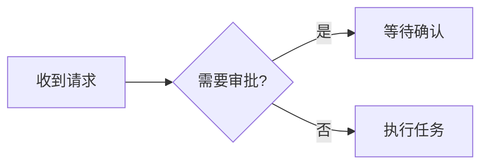

# Markdown 使用说明

Agent 回复、历史回复和文件栏的 Markdown 预览使用相同渲染组件。用户消息按原文显示，保留开头空格、Tab、连续空行、反斜杠及 Markdown 标记；`#` 注释不会变成标题，列表、加粗和代码围栏也保留原样。识别出的链接仍可点击，其原始文字不变。复制、重载和放大阅读采用同样的原文。

## 代码

在 Agent 回复或 Markdown 文件中，使用三个反引号或波浪线包围代码，在开头写上语言名即可启用高亮。语言名不区分大小写。

````markdown
```cpp
#include <iostream>

int main() {
    std::cout << "Hello\n";
}
```
````

以下 Markdown 语法适用于 Agent 回复和文件预览，包括四空格缩进代码块、列表及引用中的代码块。行内代码用单个反引号包围；跨行的行内代码仍按 Markdown 规则显示在段落中。用户消息中的这些符号作为原文显示。

代码块保留缩进和空行，提供行号、复制、横向滚动及换行开关。复制不包含行号和围栏标记。回复持续生成时立即显示新内容，稍后补充高亮。未指定语言或未知语言按纯文本显示；显式使用 `text` 可展示原始 Markdown、公式和图表语法。

超过 300 行或 2.4 万字符的内容支持连续滚动，无需手动切段。超长用户消息的源码与预览均保留原文；Agent 的长 Markdown 消息默认打开源码，可切换“预览”。大型 Markdown 文件继续提供“预览／源码”切换并记住文件模式偏好。源码视图支持全文查找、跳转行、复制全文及跟随输出末尾，只为视口附近创建文本节点。

长文预览在独立 worker 中解析完整文档，再按可见范围显示渲染结果，保留跨段引用、代码围栏、数学公式和脚注。长列表保持编号，长表格分段连续显示并重复列标题。切换预览和源码后保留各自的阅读位置；解析失败可以重试或返回源码。远程图片与原始 HTML 仍遵循下方的链接与安全规则。

消息、代码和文件预览均提供“放大阅读”；正文和代码增大字号，代码和长文使用随窗口调整的默认高度，大段代码与长文可拖动底边调整高度。放大 Agent 消息默认渲染 Markdown，用户消息继续显示原文，长文仍可切回源码。按 Esc 关闭放大视图；若正在查找或跳转到行，第一次 Esc 先关闭对应面板。

| 类别 | 支持的语言名 |
| --- | --- |
| 命令行 | shellscript、shellsession、powershell、bat |
| 数据与配置 | json、jsonc、json5、yaml、toml、xml、ini、dotenv |
| Web | javascript、typescript、jsx、tsx、vue、svelte、html、css、scss |
| 常用编程语言 | c、cpp、csharp、java、kotlin、go、rust、python、php、ruby、lua、r、swift、objective-c、dart |
| 查询与接口 | sql、graphql、http、proto |
| 构建与部署 | dockerfile、make、cmake、nginx |
| 文档与差异 | markdown、latex、mermaid、diff |

常用别名包括 `js`、`ts`、`py`、`rb`、`C++`、`C#`、`bash`、`sh`、`pwsh`、`ps1`、`batch`、`cmd`、`console`、`yml`、`protobuf`、`tex` 和 `mmd`。

文件源码预览共用这些语法，并识别 `.hpp/.cc/.cxx`、`.psm1/.psd1` 等扩展名，以及 Dockerfile、Makefile、CMakeLists.txt、nginx.conf、`.env`、`.env.example`、`.bashrc`、tsconfig.json 等常见文件名。

## 公式

行内公式可使用 `$…$` 或 `\(…\)`，例如 `$(-\frac{1}{2}) \times 3$`、`$-1\frac{1}{2}$`。

独立公式可使用 `$$…$$` 或 `\[…\]`。`$$` 既可以和公式写在同一行，也可以分别放在前后的独立行；在列表步骤、引用中同样适用：

```text
1. 分子乘分子，分母乘分母：
   $$-\frac{1 \times 3}{2 \times 1} = -\frac{3}{2}$$
```

```text
$$
\frac{1}{2} + \sum_{n=1}^{3} n
$$
```

公式通过本地 KaTeX 渲染，支持分数、上下标、根号、求和、矩阵等 KaTeX 语法；`math` 代码围栏也显示为独立公式。聊天、放大阅读、文件预览、长文预览与分享图片采用相同规则，复制仍保留原始 Markdown。

`$…$` 需要在同一行内成对出现，公式两端紧贴 `$`，结束符后不紧跟英文字母、数字或下划线；如需直接连接这些字符，可使用 `\(…\)`。这让 `$200/mo 和 $80`、`$5–$10` 等常见金额保持普通文本。需要明确显示美元符号时使用 `\$`，或放进行内代码。

行内代码和普通代码块中的公式语法按源码显示。行内公式未写完时保留可读文本，结束符补齐后自动渲染；无效 TeX 显示原始公式内容，不影响后续正文。过宽的独立公式可以单独横向滚动。

## Mermaid 图表

使用 `mermaid` 或 `mmd` 代码块描述流程图、时序图等 Mermaid 图表：

````markdown

````

点击图表可放大、缩放和拖动，按 Escape 返回。工具栏可切换图表/源码、复制原始代码；源码视图支持行号与换行。语法未完成或有错误时仍显示源码及解析原因，后续回复补全后会重新尝试渲染。图表随浅色/深色主题更新。

## 其他格式

支持一至六级标题、粗体、斜体、双波浪线删除线、嵌套列表、引用、分隔线、表格和脚注。单波浪线保持原文，方便展示 shell 路径和提示符。任务列表显示勾选状态，复选框只读：

```markdown
- [x] 已完成
- [ ] 待处理
```

脚注引用与返回链接在当前消息内跳转，不打开文件或切换会话：

```markdown
正文引用[^note]。

[^note]: 脚注内容。
```

HTTP(S) 链接通过默认浏览器打开，会话与文件链接沿用桌面工作台的跳转。原始 HTML 不执行；远程 Markdown 图片以替代文本显示，附件图片使用应用的附件预览。渲染所需的语法、公式字体和图表组件随安装包提供。
